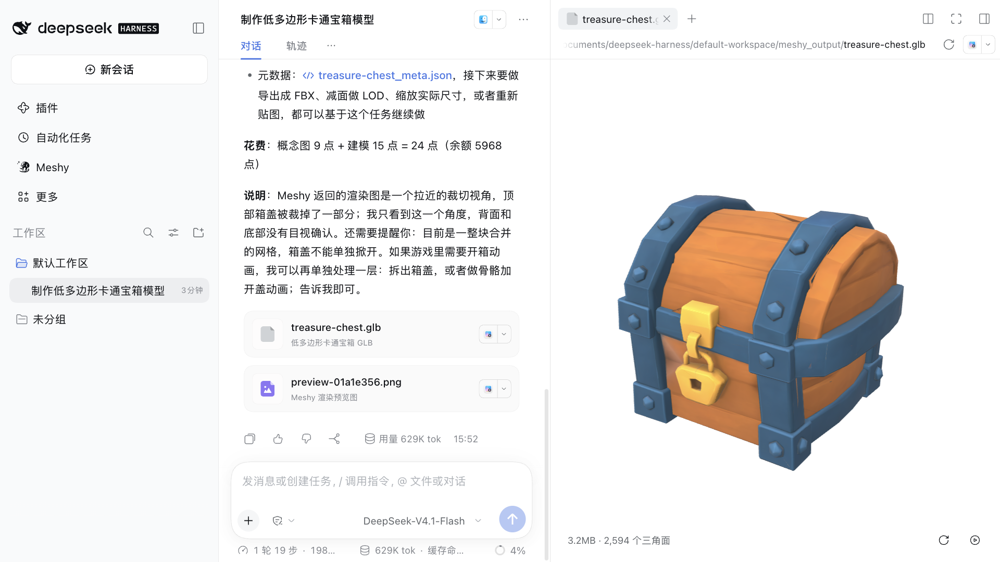
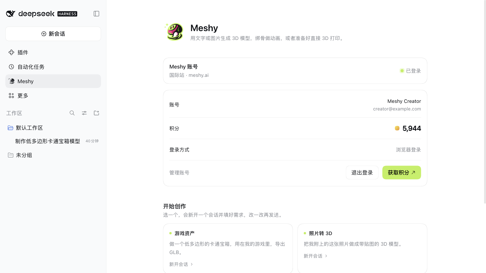

# Meshy for DeepSeek Harness

English | [中文](README.zh.md)

Native 3D generation and 3D printing for [DeepSeek Harness](https://github.com/deepseek-ai/deepseek-harness)
(dsh). The agent runs the bundled [`meshy-cli`](https://www.npmjs.com/package/meshy-cli) through
one native `meshy` tool, with a chat card for every run and your approval before anything spends
credits. A right-sidebar **Meshy Studio** shows what each chat made, `.glb` and `.3mf` previews get
a full 3D viewer (animation playback for rigs, filament colours for multi-color prints), and the
Meshy page lists your recent generations. Every
generation is the agent's: the Studio's **New** menu, the `/meshy` command and the Meshy page only
put a request in the message box for you to finish and send. The `meshy-3d-generation` and
`meshy-3d-printing` skills teach the agent the CLI, and Cordis services let other plugins build on
all of it.



## Install

```bash
dsh plugin --profile web add meshy-dsh
# or from GitHub
dsh plugin --profile web add github:meshy-dev/meshy-dsh
```

`dsh --profile web --dump-config` now shows a `# == meshy-dsh` layer, and typing `/` in `dsh web`
lists `meshy-3d-generation` and `meshy-3d-printing` in a new session. Plugins belong to one profile:
install into each one you use (`web`, `tui`, `desktop`). Then ask for a model, for example "make a
low-poly treasure chest and export FBX". The agent asks you to sign in if needed, shows the
estimated credit cost and waits for your approval before running any paid generation.

The plugin ships the Meshy CLI and keeps your sign-in on the host: dsh runs the agent's shell in a
sandbox that cannot save a login, so the plugin signs in, refreshes the session on its side and
hands it to both native tools and shell calls. Sign in once — from **Settings → Meshy**, or in a
chat through `meshy_sign_in` — and every session, new or old, is signed in; nothing is installed or
downloaded per session. Choose the China site to sign in at meshy.cn with the same account and
credits, and keep calls there. The sign-in is the CLI's own (encrypted under a key your OS keeps),
so `meshy` in your terminal shares it. dsh keeps an exported `MESHY_API_KEY` out of the agent's
shell, and the plugin does not pass it on either.

## What's included

### Native tools

- **`meshy`** runs the bundled Meshy CLI, signed in as you, with the arguments the agent passes —
  the commands the skills document, unchanged. It runs in the chat's workspace and writes nowhere
  else. A command that spends credits (`make`, `create` on a task, a non-GET `api` call) first asks
  for your approval, showing the agent's estimate and where it comes from (`make --dry-run` or the
  published price list) next to your balance, or "price unknown" when there is none; declining
  costs nothing. Generations run as dsh background jobs: several can run at once, you keep
  chatting, and the agent hears when each ends. If the CLI stops waiting, the task keeps running on
  Meshy and the agent picks it up again with `wait`, without starting a new one.
- **`meshy_sign_in`** signs you in from the chat.
- **`meshy_preview_model`** opens a model or image in the Studio.

Which commands are tasks, and so which ones spend credits, comes from the CLI itself
(`meshy resources`), so a CLI release with new commands works without a plugin change. Each run's
chat card shows the command, live progress, thumbnails and the credits actually charged, with
**View** to open the result in the Studio.

### Starting a request

Three places put a request in the message box, in the language of the interface; you finish it
and send it, and nothing runs until you do:

- The Studio's **New** menu (and its list while the chat has made nothing yet).
- The **`/meshy`** command in the message box.
- The example requests on the Meshy page, which open a new session.

**Image to 3D** takes one image, or two to four views of the same object; **Text to 3D** and
**Generate an image** start a description; **Edit an image** takes the image plus up to four
references. `/meshy` also offers **Creative Lab**: pick a photo and the agent lists what Creative
Lab can make of it (a figure, a keychain and so on) and asks which one. Picked images are saved in
the workspace under `meshy_input/` and referenced in the request (`@meshy_input/sword.png`), so the
agent works from the files.

### Right sidebar — Meshy Studio

In Web and Desktop, the right sidebar adds a **Meshy Studio** tab that follows the chat on screen.
It shows the chat's results and hands every change to the agent:

- **Models** and **Images** are kept apart, by what each task produced. Each has a large stage on
  top — a 3D viewer for models, a zoomable view for images — and a grid of everything the chat
  made below it, by the agent or by the CLI in its shell, where running generations show their
  progress. A result that is neither, such as a printability report, stays in the chat. Each
  result keeps the name it was submitted with; waiting on it later does not rename it.
- The 3D viewer follows Meshy's web app: **Solid / Unlit / Lit** render modes, the model's texture
  channels (base color, roughness, metallic, normal, emission, ambient occlusion), a wireframe
  overlay, a skeleton view for rigged models, lighting strength and rotation, a grid, face and
  vertex counts, orbit and zoom, reset view and auto-rotate.
- 3MF print files open the way Meshy's web viewer reads them (build placement, components,
  material and vertex colours, flat-shaded triangles, Z up), and a multi-color print shows its
  filament painting in the filament colours its project settings list, as Bambu Studio and Orca
  Slicer do. A print painted finer than about 1.5 million pieces shows each triangle in the
  filament that covers most of it. A slicer project's negative volumes, modifiers and support
  blockers or enforcers are left out, since they are not printed.
- Rigged and animated models play: play / pause, a timeline, playback speed and a pick of clips (a
  rigging result has walking and running).
- Next steps sit in a toolbar over the stage and fit the asset: refine, retexture, remesh or
  UV-unwrap a model; prepare it for 3D printing, or take one step of that (check printability,
  repair, a multi-color 3MF, split into parts, set its real-world size, open it in a slicer); rig
  it; download a format it already has or convert it to another; give a rigged model a new
  animation; send a 3MF print file to the slicer; turn an image into 3D or edit it. A step goes
  into your message box as a request to send or change. Any asset can open in a tab of its own.
- One Studio per chat: opening it again, from a card or a model preview, brings back the one
  already open, in whichever pane it is.

### Left sidebar — Meshy page, recent generations and Settings

The **Meshy** entry in the left sidebar opens the Meshy page with your account summary, your
**recent generations** and starter requests (pick one to open a new session prefilled and ready to
edit). Recent generations lists the models and images on your Meshy account that are still
available — Meshy keeps generated files for 3 days — so you can preview them or continue with one
in a new session. Files the agent saved stay in their session's workspace.



**Settings → Meshy** (also the plugin's page under **Plugins**) shows the plugin and Meshy CLI
versions, sign-in method (browser or API key), account name and email (when reported by the site),
site (`meshy.ai` or `meshy.cn`) and credit balance. **Sign in to Meshy** shows the approval link
with a QR code for your phone and the code to check; the page picks up the approval automatically.

### Upgraded GLB and 3MF preview

Clicking any `.glb` or `.3mf` file in the workspace opens the interactive 3D preview with the same
viewer toolbar and animation playback as the Studio. Models up to 256 MB open, past dsh's 32 MB limit for
previewing a whole file, because the viewer streams them in 2 MB pieces.

`tui` and headless profiles have no browser UI; the tools and skills work the same everywhere.

## Composing with Cordis & Creator Mode

`meshy-dsh` provides two public Cordis services so other plugins — or custom extensions generated
in dsh Creator Mode — can build on Meshy without shelling out to the CLI or duplicating auth and
UI wiring.

### Host service: `ctx.inject(['meshy'])`

| Member | Description |
|---|---|
| `version` | Contract version (`1`). |
| `status()` | `Promise<{ authenticated, verified, region, account, balance }>` |
| `tasks.session(sessionId, opts?)` | `Promise<{ workspace, tasks, models }>` for a session. |
| `tasks.library({ resource?, limit?, refresh? }?)` | `Promise<{ authenticated, items }>` from the signed-in Meshy account. |
| `tasks.get(resource, taskId)` | `Promise<{ view?, failed? } \| undefined>` for a single task. |
| `models.list(workspace)` | `Promise<ModelFile[]>` — `.glb` and `.3mf` files in a workspace, newest first. |
| `models.announce(workspace, file, meta?)` | Announces a new workspace `.glb` or `.3mf` to listeners and the Studio. |
| `ui.openModel(sessionId, target)` | Opens the Meshy Studio on `{ file }` or `{ resource, taskId }`. |
| `ui.openTasks(sessionId)` | Opens the Meshy Studio. |
| `run({ agent, callId?, signal?, requester?, args, estimatedCredits?, estimateSource?, title? })` | Runs one Meshy CLI command in a chat the way the `meshy` tool does — same approval, same card data — and resolves when it ends. |
| `subscribe(listener)` | Live `task`, `asset`, `model` and `open` events; returns an unsubscribe function. |

There is no price table or per-operation generator: prices and commands belong to the CLI, so a
plugin passes CLI arguments to `run()`, with the estimate it got from the CLI.

### Client service: `ctx.inject(['meshyUi'])`

| Member | Description |
|---|---|
| `version` | Contract version (`1`). |
| `openTab(target?)` | Opens the Meshy Studio for the chat on screen, optionally on `{ file }` or `{ resource, taskId }`. |
| `openStudioPage()` | Navigates to the left-sidebar Meshy page. |

### Example: a tool that exports a finished model

A plugin's own tool can hand a CLI command to Meshy inside the agent's turn; the user approves it
like any other Meshy run when it spends credits:

```js
export const name = 'meshy-export-fbx'

export function apply(ctx) {
  ctx.inject(['meshy', 'tools'], (ctx) => {
    ctx.tools.register({
      name: 'export_fbx',
      description: 'Save the FBX of a finished Meshy task into exports/fbx/.',
      parameters: {
        type: 'object',
        properties: { resource: { type: 'string' }, task_id: { type: 'string' } },
        required: ['resource', 'task_id'],
      },
      execute: (args, { agent, callId, signal }) => ctx.meshy.run({
        agent, callId, signal, requester: 'FBX export',
        args: ['download', '--resource', args.resource, '--task-id', args.task_id,
          '--model-format', 'fbx', '--output-dir', 'exports/fbx'],
      }),
    })
  })
}
```

On the browser side, another UI plugin can jump straight to a model in the right sidebar:

```ts
ctx.inject(['meshyUi'], (ctx) => {
  ctx.meshyUi.openTab({ file: 'meshy_output/chest.glb' })
})
```

In dsh Creator Mode, you can ask dsh to scaffold a plugin around these services directly — for
example: *"Build a dsh plugin using `ctx.inject(['meshy'])` that listens for finished 3D models
and logs each model's name and credits to `assets/manifest.json`."*

## Update

dsh never updates a plugin it installed, so you keep the version you added until you reinstall it.
In Web and Desktop, the Meshy page and **Settings → Meshy** say when a newer version is out, and a
dot appears on the sidebar entry. A release shows up there once it is a day old: until then dsh's
installer would still pick the previous one. To update, uninstall Meshy on its page under
**Plugins** and add `meshy-dsh` again; from a terminal, `dsh plugin --profile web remove meshy-dsh`
followed by the `add` command above. You stay signed in.

## How it works

[`cordis.patch.yml`](cordis.patch.yml) mounts one more instance of dsh's built-in filesystem
skill provider over this package's `skills/` directory, so the skills load like any local skill,
and loads the package itself:

- **Host (`lib/index.js` and siblings)** — keeps the sign-in fresh, injects the bundled CLI
  (`DSH_MESHY_NODE`, `DSH_MESHY_CLI`), access credential (`DSH_MESHY_CREDENTIAL`,
  `DSH_MESHY_REGION`, `DSH_MESHY_SUBJECT`, never the refresh token) and the chat's own operation
  journal (`DSH_MESHY_STATE_DIR`, `.meshy/sessions/<chat>` in the workspace) into shell calls,
  registers the `meshy`, `meshy_sign_in` and `meshy_preview_model` tools, provides the `meshy`
  Cordis service, and serves the authenticated `/api/meshy.*` routes (status, login/logout,
  update check, session tasks, account library, model streaming, saving picked images into
  `meshy_input/`, live events and the bundled studio HDR map). It reads which commands exist from
  `meshy resources` and holds no command list, model name or price of its own.
- **Browser (`lib/client.js`, built from `src/client/`)** — provides the `meshyUi` Cordis service,
  the right-sidebar Meshy Studio tab, the `/meshy` command, chat cards for the three tools, the
  left-sidebar Meshy page with recent generations, **Settings → Meshy**, and the `.glb` / `.3mf`
  preview.
  `three` is split into `lib/client.viewer.js` and loaded lazily on first 3D preview.
- **Skills & metadata** — a skill of the same name in your project's `.dsh/skills` or
  `.agents/skills` takes precedence. `locale/` and `icon.svg` are what dsh's Plugin Manager shows.

`skills/` is a copy of the CLI skills in
[meshy-3d-agent](https://github.com/meshy-dev/meshy-3d-agent), which owns them and serves every
other agent host. Change them there.

## Development

```bash
npm ci && npm run build                             # rebuild lib/client*.js from src/client/ (committed)
npm test                                            # manifest, client wrappers, host routes, tools, services, packed files
node scripts/sync-skills.mjs --check                # skills/ matches the pinned meshy-3d-agent release
node scripts/smoke.mjs                              # install into a throwaway dsh and load the skills
node scripts/sync-skills.mjs --from ../meshy-3d-agent   # try unreleased skills from a checkout
```

To take new skills: release meshy-3d-agent, set `meshy.skills` in `package.json` to its tag, run
`node scripts/sync-skills.mjs`, and bump the version.

## Release

Bump `version` in `package.json` and add a `CHANGELOG.md` entry, then create a GitHub Release
tagged `v<version>` and run [`publish.yml`](.github/workflows/publish.yml) from `main` with that
tag. It checks the tag against `package.json`, runs the checks above and publishes with
provenance through npm trusted publishing (GitHub OIDC), so no npm token is stored anywhere.
Do not publish by hand.

## License

MIT
