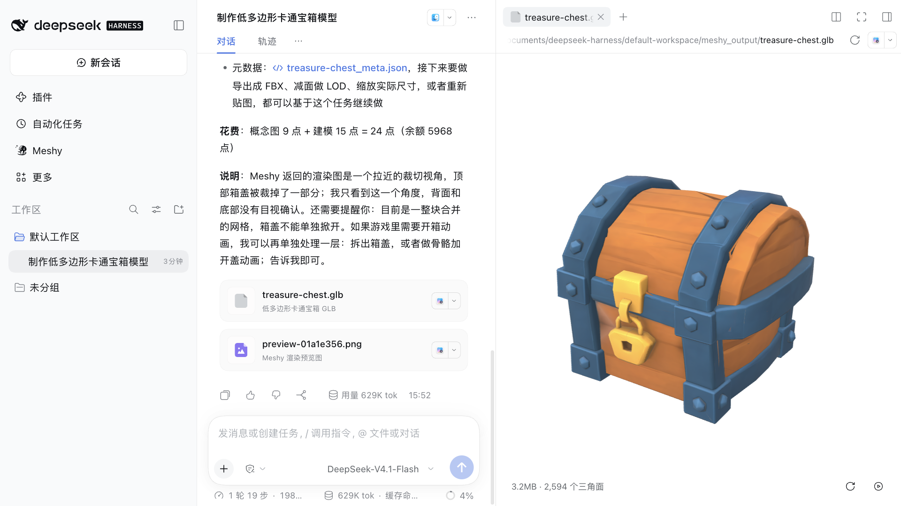
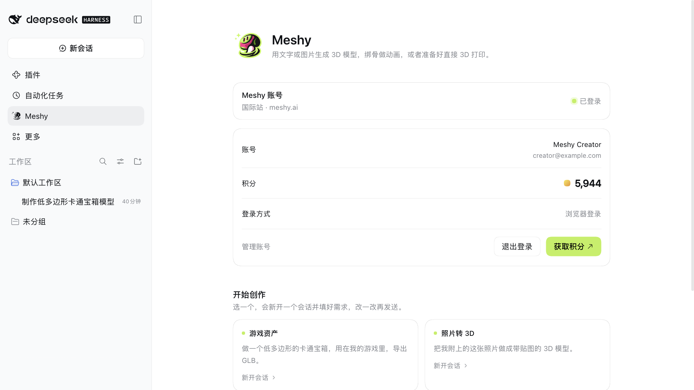

# Meshy for DeepSeek Harness

[English](README.md) | 中文

为 [DeepSeek Harness](https://github.com/deepseek-ai/deepseek-harness)（dsh）提供原生 3D 生成与 3D 打印能力。agent 通过一个原生 `meshy` 工具运行内置的 [`meshy-cli`](https://www.npmjs.com/package/meshy-cli)，每次运行都有聊天卡片，花积分前先等你确认。右侧栏 **Meshy Studio** 展示每个对话生成的内容，`.glb` 和 `.3mf` 预览升级为完整的 3D 查看器（绑骨模型可播放动画，多色打印文件显示耗材颜色），Meshy 页面列出你最近的生成。所有生成都由 agent 完成：Studio 的**新建**菜单、`/meshy` 命令和 Meshy 页面只会把请求放进输入框，由你补充后发送。`meshy-3d-generation` 和 `meshy-3d-printing` skill 教 agent 使用 CLI，Cordis 服务让其他插件可以在这一切之上扩展。



## 安装

```bash
dsh plugin --profile web add meshy-dsh
# 或从 GitHub 安装
dsh plugin --profile web add github:meshy-dev/meshy-dsh
```

装好后，`dsh --profile web --dump-config` 里会出现 `# == meshy-dsh` 一层；在 `dsh web` 的输入框里输入 `/`，能看到 `meshy-3d-generation` 和 `meshy-3d-printing`（装完要新开会话）。插件按 profile 安装，你用哪个 profile（`web`、`tui`、`desktop`）就要往哪个里装。然后直接提需求，比如"做一个低多边形的宝箱，导出 FBX"。需要时 agent 会引导你登录，每次发起付费生成前都会展示预计消耗的积分并等待你确认。

插件自带 Meshy CLI，登录也由宿主端保管：dsh 让 agent 的 shell 跑在沙箱里，没法保存登录，所以由插件登录、在宿主侧刷新登录态，再同时提供给原生工具和 shell 调用。在**设置 → Meshy** 里登录一次，或在聊天里通过 `meshy_sign_in` 工具扫码/核对验证码完成登录，之后所有新旧会话都是已登录状态，每个会话也不用再安装或下载任何东西。选中国站会在 meshy.cn 用同一个账号登录，额度也和国际站通用，之后的调用都走中国站。这份登录就是 CLI 自己的登录（用系统保管的密钥加密），所以终端里的 `meshy` 也共用它。dsh 不会把你 export 的 `MESHY_API_KEY` 带进 agent 的 shell，插件也不会转交它。

## 包含的功能

### 原生工具

- **`meshy`**：以你的登录身份运行内置 Meshy CLI，参数就是 agent 传入的那些——skill 里写的命令，原样执行。它在当前对话的 workspace 里运行，也只写这个目录。会花积分的命令（`make`、任务的 `create`、非 GET 的 `api` 调用）会先请你确认：显示 agent 给出的预估及其来源（`make --dry-run` 或公开价格表）和你的余额，没有预估时显示"价格未知，以实际扣费为准"；拒绝不花任何积分。生成作为 dsh 后台任务运行：可以同时跑多个，你可以继续聊天，每个结束时 agent 都会收到通知。CLI 等待超时后任务仍在 Meshy 上继续，agent 会用 `wait` 接着等，不会重新提交。
- **`meshy_sign_in`**：在聊天里登录。
- **`meshy_preview_model`**：在 Studio 中打开某个模型或图片。

哪些命令是任务、因此会花积分，由 CLI 自己说了算（`meshy resources`），所以 CLI 新增命令后插件不用改就能用。每次运行的聊天卡片会显示命令、实时进度、缩略图和实际扣除的积分，点**查看**可在 Studio 中打开结果。

### 发起请求

有三个地方会按界面语言把请求放进输入框；由你补充并发送，发送之前什么都不会运行：

- Studio 的**新建**菜单（对话还没有生成内容时，Studio 里也会直接列出）。
- 输入框里的 **`/meshy`** 命令。
- Meshy 页面上的示例需求，会新开一个会话。

**图片生成 3D** 接受一张图片，或同一物体的两到四个视角；**文字生成 3D** 和**生成图片**会起一句描述的开头；**编辑图片**接受要改的图片外加最多四张参考图。`/meshy` 还多一个**创意工坊**：选一张照片，agent 会先列出创意工坊能把它做成什么（手办、钥匙扣等），再问你选哪个。选中的图片会保存到 workspace 的 `meshy_input/` 下，并在请求里引用（`@meshy_input/sword.png`），agent 直接用这些文件。

### 右侧栏 —— Meshy Studio

在 Web 和 Desktop 里，右侧栏新增跟随当前对话的 **Meshy Studio** 标签页。它负责展示对话的结果，所有修改都交给 agent：

- **模型**和**图片**按任务实际产出分开展示。上方是大舞台——模型用 3D 查看器，图片可缩放查看——下方是本对话生成内容（来自 agent，或 agent 在 shell 里运行的 CLI）的缩略图网格，正在生成的会显示进度。既不是模型也不是图片的结果（比如可打印性检查报告）留在对话里。每个结果沿用提交时的名字，之后等待它完成不会改名。
- 3D 查看器对齐 Meshy 网页版：**实体 / 无光影 / 真实光照** 三种渲染模式，基础色、粗糙度、金属度、法线、自发光、环境光遮蔽等贴图通道，线框叠加，绑骨模型的骨骼显示，光照强度与旋转，网格，面数和顶点数，旋转缩放、复位视角和自动旋转。
- 3MF 打印文件按 Meshy 网页版查看器的方式读取（摆放位置、组件、材质色与顶点色、平面着色、Z 轴朝上），多色打印文件按项目设置里的耗材颜色显示涂色，和 Bambu Studio、Orca Slicer 一致。涂色细分超过约 150 万块时，每个三角面显示占它面积最多的那种耗材颜色。切片项目里的负体积、修改器和支撑阻断/强制部件不会打印，因此不显示。
- 绑骨和带动画的模型可以播放：播放 / 暂停、进度条、播放速度和动画切换（绑骨结果自带走路和跑步）。
- 后续操作放在舞台底部的工具条里，按类型给出：模型可以精细贴图、重新贴图、重拓扑、UV 展开，准备 3D 打印或只做其中一步（检查可打印性、修复、多色 3MF、拆分部件、设置实际尺寸、在切片软件中打开），绑骨，下载已有的格式或转换为其他格式；绑好骨骼的模型可以换个动画；3MF 打印文件可以送进切片软件；图片可以转为 3D 或修改。操作会作为请求放进输入框，发送前可以修改。任何资产都能在单独的标签页打开。
- 每个对话只有一个 Studio：从卡片或模型预览再次打开时，会回到已经打开的那个，不管它在哪个面板里。

### 左侧栏 —— Meshy 页面、最近生成与设置页

左侧栏的 **Meshy** 入口打开 Meshy 页面，包含账号信息、**最近生成**以及示例需求（点一个即可新开会话并填好提示词）。最近生成列出你 Meshy 账号下仍可获取的模型和图片（Meshy 只保留 3 天内生成的文件），可以预览，或在新会话中继续使用。Agent 已保存的文件留在对应会话的 workspace 里。



**设置 → Meshy**（插件页里也有）显示插件和 Meshy CLI 的版本、登录方式（浏览器或 API key）、登录账号（站点返回时显示名字和邮箱）、所在站点（meshy.ai 或 meshy.cn）和剩余积分。点**登录 Meshy**会显示批准链接、手机二维码和核对验证码，页面会自动感知批准完成。

### 升级版 GLB 与 3MF 预览

在 workspace 里点击任意 `.glb` 或 `.3mf` 文件即可打开交互式 3D 预览，工具栏和动画播放与 Studio 相同。预览按 2 MB 分块读取模型，不受 dsh 整文件预览 32 MB 的限制，最大可预览 256 MB。

`tui` 和 headless 没有浏览器界面，工具和 skill 在所有 profile 下都一样能用。

## 与 Cordis 及 Creator Mode 组合扩展

`meshy-dsh` 暴露了两个公共 Cordis 服务，其他插件或通过 dsh Creator Mode 生成的自定义扩展可以直接复用 Meshy 的鉴权、任务、模型和 3D 预览能力，无需自己拼 CLI 或重写界面。

### 宿主侧服务：`ctx.inject(['meshy'])`

| 成员 | 说明 |
|---|---|
| `version` | 接口版本（`1`）。 |
| `status()` | `Promise<{ authenticated, verified, region, account, balance }>` |
| `tasks.session(sessionId, opts?)` | 返回指定会话的 `{ workspace, tasks, models }`。 |
| `tasks.library({ resource?, limit?, refresh? }?)` | 返回当前登录账号最近的任务列表 `{ authenticated, items }`。 |
| `tasks.get(resource, taskId)` | 查询单个任务详情。 |
| `models.list(workspace)` | 列出 workspace 中的 `.glb` 和 `.3mf` 文件（按最新排序）。 |
| `models.announce(workspace, file, meta?)` | 向监听方与 Studio 广播新的 workspace `.glb` 或 `.3mf` 文件。 |
| `ui.openModel(sessionId, target)` | 打开 Meshy Studio 并定位到 `{ file }` 或 `{ resource, taskId }`。 |
| `ui.openTasks(sessionId)` | 打开 Meshy Studio。 |
| `run({ agent, callId?, signal?, requester?, args, estimatedCredits?, estimateSource?, title? })` | 在某个对话里运行一条 Meshy CLI 命令，与 `meshy` 工具完全一致（同样的确认、同样的卡片数据），命令结束后返回结果。 |
| `subscribe(listener)` | 订阅实时的 `task`、`asset`、`model`、`open` 事件，返回取消订阅函数。 |

服务里没有价格表，也没有按操作区分的生成接口：价格和命令都归 CLI 管，插件把 CLI 参数和它从 CLI 拿到的预估传给 `run()` 即可。

### 浏览器侧服务：`ctx.inject(['meshyUi'])`

| 成员 | 说明 |
|---|---|
| `version` | 接口版本（`1`）。 |
| `openTab(target?)` | 为当前屏幕上的对话打开 Meshy Studio，可选定位到 `{ file }` 或 `{ resource, taskId }`。 |
| `openStudioPage()` | 跳转到左侧栏的 Meshy 页面。 |

### 示例：导出已完成模型的工具

插件自己的工具可以在 agent 的回合里把一条 CLI 命令交给 Meshy；如果会花积分，用户会像其他 Meshy 运行一样先确认：

```js
export const name = 'meshy-export-fbx'

export function apply(ctx) {
  ctx.inject(['meshy', 'tools'], (ctx) => {
    ctx.tools.register({
      name: 'export_fbx',
      description: 'Save the FBX of a finished Meshy task into exports/fbx/.',
      parameters: {
        type: 'object',
        properties: { resource: { type: 'string' }, task_id: { type: 'string' } },
        required: ['resource', 'task_id'],
      },
      execute: (args, { agent, callId, signal }) => ctx.meshy.run({
        agent, callId, signal, requester: 'FBX export',
        args: ['download', '--resource', args.resource, '--task-id', args.task_id,
          '--model-format', 'fbx', '--output-dir', 'exports/fbx'],
      }),
    })
  })
}
```

在浏览器侧，其他 UI 插件也可以直接唤起右侧栏预览指定模型：

```ts
ctx.inject(['meshyUi'], (ctx) => {
  ctx.meshyUi.openTab({ file: 'meshy_output/chest.glb' })
})
```

在 dsh Creator Mode 里，你也可以直接让 dsh 基于这些服务帮你生成插件，例如：*"用 `ctx.inject(['meshy'])` 写一个 dsh 插件，监听已完成的 3D 模型，把每个模型的名称和消耗积分记录到 `assets/manifest.json`。"*

## 更新

dsh 不会自动更新已安装的插件，重新安装之前一直是你当初装的版本。在 Web 和 Desktop 里，有新版本时 Meshy 页面和**设置 → Meshy** 会提示，左侧栏的入口上也会出现一个小圆点。新版本发布满一天才会提示，因为在那之前 dsh 安装插件时仍会选上一个版本。更新方法：在**插件**里打开 Meshy 的页面卸载，再重新添加 `meshy-dsh`；在终端里则先运行 `dsh plugin --profile web remove meshy-dsh`，再运行上面的 `add` 命令。登录状态会保留。

## 工作方式

[`cordis.patch.yml`](cordis.patch.yml) 挂载一个 dsh 内置的文件系统 skill provider 扫描本包的 `skills/` 目录，并加载本包自身：

- **宿主端（`lib/index.js` 及配套模块）**：维护并刷新登录态，为每次 shell 调用注入内置 CLI（`DSH_MESHY_NODE`、`DSH_MESHY_CLI`）、访问凭证（`DSH_MESHY_CREDENTIAL`、`DSH_MESHY_REGION`、`DSH_MESHY_SUBJECT`，从不包含 refresh token）和当前对话自己的操作日志目录（`DSH_MESHY_STATE_DIR`，即 workspace 下的 `.meshy/sessions/<对话>`）；注册 `meshy`、`meshy_sign_in`、`meshy_preview_model` 三个工具并提供 `meshy` Cordis 服务；提供带鉴权的 `/api/meshy.*` 接口（状态、登录/退出、更新检查、会话任务、账号模型库、模型流式读取、把选中的图片存入 `meshy_input/`、实时事件与内置 HDR 环境贴图）。有哪些命令从 `meshy resources` 读取，插件自己不维护命令列表、模型名或价格。
- **浏览器端（`lib/client.js`，由 `src/client/` 构建）**：提供 `meshyUi` Cordis 服务、右侧栏 Meshy Studio 标签页、`/meshy` 命令、三个工具的聊天卡片、带最近生成的左侧栏 Meshy 页面、**设置 → Meshy** 以及 `.glb` / `.3mf` 预览；three.js 单独拆在首次使用时才加载的 `lib/client.viewer.js` 中。
- **Skill 与元数据**：项目里 `.dsh/skills` 或 `.agents/skills` 下的同名 skill 优先。`locale/` 和 `icon.svg` 是 dsh 插件管理页显示的名称、简介和图标。

`skills/` 是 [meshy-3d-agent](https://github.com/meshy-dev/meshy-3d-agent) 里 CLI skill 的副本；那个仓库负责维护，也服务其他所有 agent 宿主。修改请提到那边。

## 开发与发布

命令见 [README.md](README.md#development)。发布方式：更新 `package.json` 版本与 `CHANGELOG.md`，然后建标签为 `v<版本号>` 的 GitHub Release，再从 `main` 手动运行 `publish.yml` 并填入这个标签。它通过 npm trusted publishing（GitHub OIDC）发布并附带 provenance，任何地方都不保存 npm token。不要手动 `npm publish`。

## 许可

MIT
